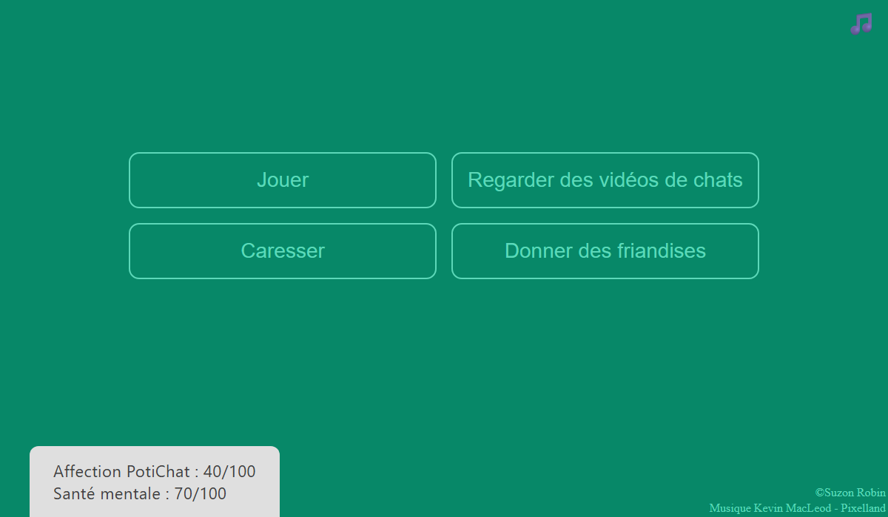
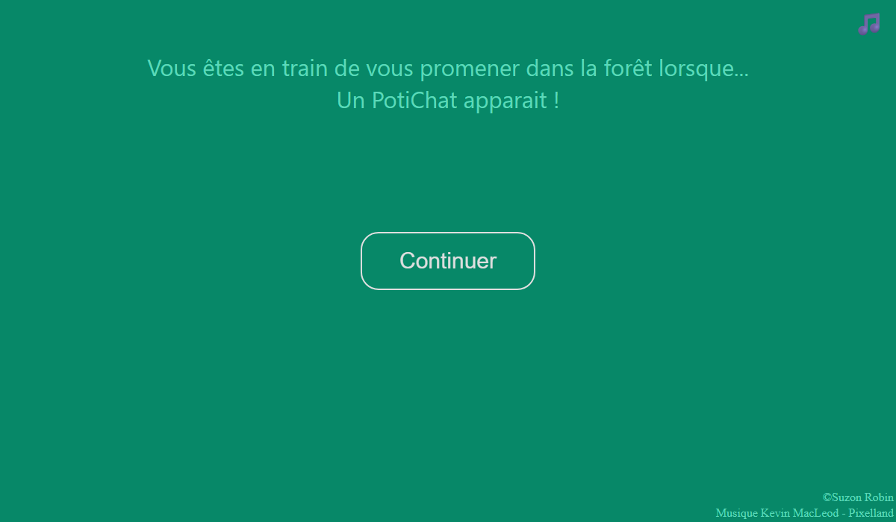
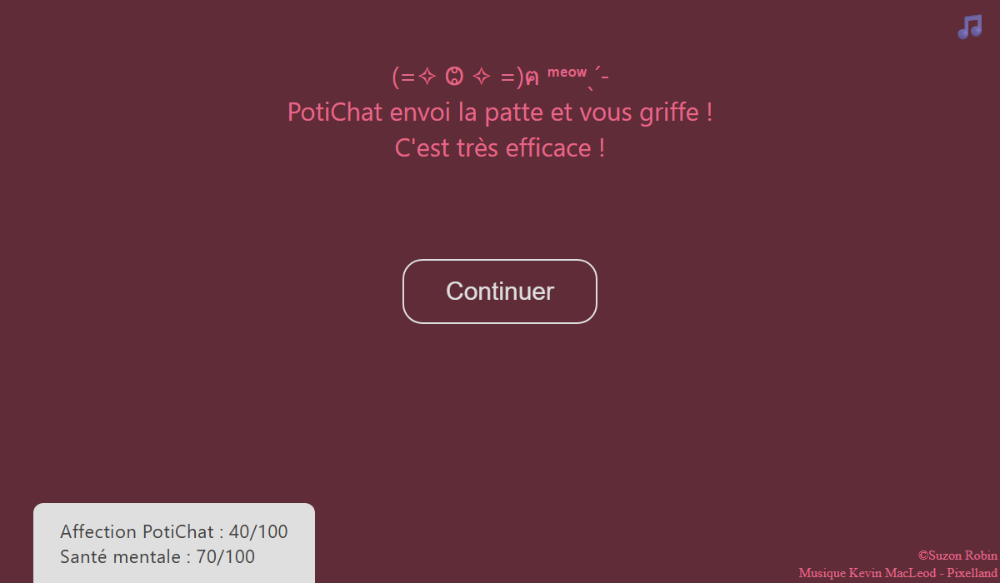
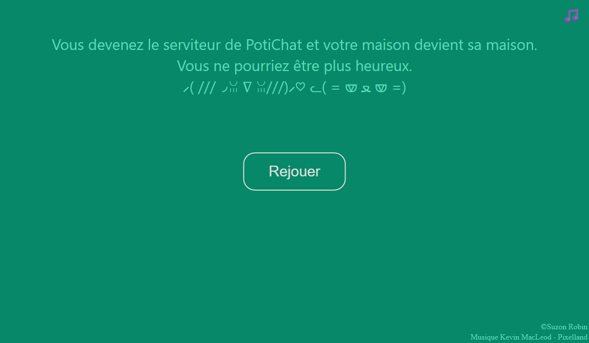

# PotiChat

A small turn-based game in the browser, in the spirit of a *Pokémon* wild encounter… with a twist.

You are walking in the forest when a wild PotiChat appears. As in *Pokémon*, you take turns:
you pick an action, then the creature answers with its own move (“PotiChat uses Hiss!”, “It's super effective!”).
But here, you don't fight it or try to catch it: the goal is to win its heart.
Play with it, pet it, give it treats… and earn its affection before your mental health drops to zero.
In the end, it's not you who catches the cat: it's the cat who adopts you.

**[▶ Play in your browser](https://suzonz.github.io/PotiChat/)**



| Intro | PotiChat's turn | Happy ending |
|---|---|---|
|  |  |  |

The game is in French.

## Play

Play it online with the link above, or open `index.html` in a browser (Chrome, Firefox, Edge…). Nothing to install.
It works with a mouse or on a touch screen, and the layout adapts to phones.

The 🎵 button in the top right corner turns the music on and off.

## Rules

You start with **0 affection** and **100 mental health**. Each round, you pick an action, then PotiChat answers with one of its own.
Every action can succeed or fail: the result is partly random.

- **PotiChat's affection reaches 100**: it follows you home. You win (sort of).
- **Your mental health drops to 0**: you collapse, and PotiChat leaves with a contemptuous look.

### Your actions

| Action | If it works |
|---|---|
| Play (wave a stick) | +10 affection |
| Watch cat videos | +15 mental health |
| Pet | +20 affection |
| Give treats | +30 affection |

The better the reward, the more likely the action is to fail.

### PotiChat's moves

| Move | If it works |
|---|---|
| Ignore | −10 mental health |
| Grooming | −15 affection (it feels clean and independent) |
| Hiss | −20 mental health |
| Feint, then scratch | −30 mental health |

The colours change with the turn: green for you, dark red for PotiChat.

## Project structure

```
index.html            page: story, choice buttons, stats, music
assets/
  css/style.css       layout, the two colour themes, phone layout
  js/main.js          the whole game: story, actions, PotiChat's moves, stats, endings
  sounds/             background music
screenshots/          images used in this README
```

The game started as a console version with Node.js, then moved to the browser.

## Credits

- Game, code and story: **Suzonz**
- Music: *Pixelland* by Kevin MacLeod ([incompetech.com](https://incompetech.com)),
  licensed under [Creative Commons: By Attribution 4.0](https://creativecommons.org/licenses/by/4.0/)

## License

The code is released under the [MIT License](LICENSE).
The music keeps its own license (see above).
